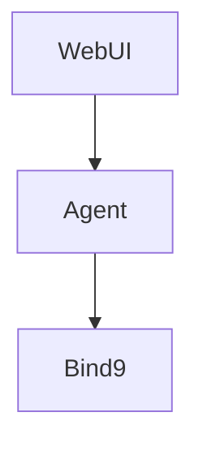

# vanzhiganov.github.io

Personal site of **vyacheslav anzhiganov**, built with [Jekyll](https://jekyllrb.com/)
and the [Type Theme](https://github.com/rohanchandra/type-theme).

## Local development

Install Ruby and Bundler, then run:

```sh
bundle install
bundle exec jekyll serve
```

The site is served at <http://localhost:4000>.

## Content

- `index.html` &ndash; home page with the blog listing (`layout: home`). Posts are
  paginated 5 per page; older pages live at `/page2/`, `/page3/`, ... (see
  `paginate` / `paginate_path` in `_config.yml`).
- `contacts.html` &ndash; contacts and tweets (hidden from the navigation).
- `blog.md` &ndash; legacy `/blog/` URL; redirects to the home page.
- `_posts/` &ndash; blog posts (drop a Markdown file named `YYYY-MM-DD-title.md`
  with `layout: post` front matter to publish).
- `_config.yml` &ndash; site and theme settings (title, social icons, analytics, etc.).

## Diagrams

Posts can embed [Mermaid](https://mermaid.js.org/) block diagrams. Add
`diagrams: true` to the front matter and use a fenced code block:

~~~markdown
---
layout: post
title: "Architecture"
diagrams: true
---


~~~

Mermaid is loaded from a CDN and rendered in the browser, and only on pages
that opt in, so diagram-free pages stay lightweight. Raw
`<div class="mermaid">…</div>` blocks work as well.

Note: the `jekyll-diagrams` entry in `_config.yml` is inert here. That plugin
renders at build time with external tools, and GitHub Pages only runs
whitelisted plugins, so it is skipped in production (and would be unavailable
locally too). Diagram rendering is done client-side instead.

## Styling

The site uses a **dark colour palette** defined in `_sass/base/_variables.scss`
(background, text, link and border colours). Code highlighting lives in
`_sass/external/_syntax.scss`, and site-specific styles are in `_sass/_custom.scss`.

## Custom domain

The custom domain (`anzhiganov.com`) is stored as `CNAME.bak`. Rename it to
`CNAME` and set `url: "https://anzhiganov.com"` in `_config.yml` to enable it.

## Deployment

This repository is a GitHub Pages user site, so any push to `master` is built
and published automatically by GitHub Pages.
